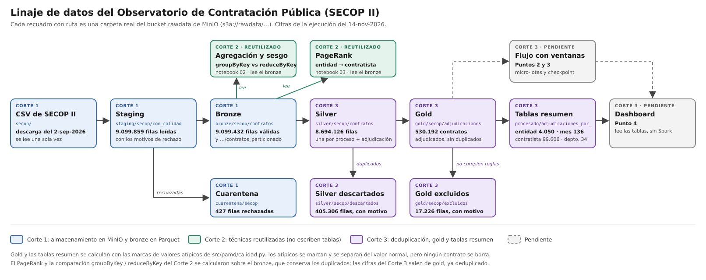

# Articulación de los cortes y linaje de datos (T1.6)

El Corte 3 no rehace los cortes anteriores: se apoya en ellos. Del Corte 1 conserva la separación entre almacenamiento y cómputo (MinIO guarda, Spark calcula) y el bronze en Parquet, con su cuarentena de 427 registros inválidos; el CSV de SECOP II se lee una sola vez. Del Corte 2 reutiliza la agregación parcial (`groupBy().agg()` en DataFrames, el equivalente de `reduceByKey`, que movió 5,2 veces menos datos en el shuffle que `groupByKey`) para construir las tablas resumen; la regla de identificador de contratista del PageRank entidad → contratista (NIT, luego código, luego nombre); y la lección del sesgo: apenas el 2,5 % de las entidades concentra la mitad de los registros, así que los rankings dependen de pocos actores. Lo nuevo del Corte 3 es limpiar lo que el bronze conserva: silver deja una fila por proceso y adjudicación, gold deja solo los contratos adjudicados con fecha, entidad y contratista, y las tablas de `procesado/` resumen gold por entidad, contratista, departamento y mes, con los valores atípicos marcados y separados del valor normal. Sobre gold se construirán el flujo con ventanas, los resultados idempotentes y el dashboard. Las cifras del Corte 2 se calcularon sobre el bronze, que conserva las repeticiones (9.099.432 registros), y las del Corte 3 sobre gold, ya deduplicado (530.192 contratos): no son comparables entre sí.

El diagrama se genera con `scripts/dibujar_linaje.py` (`docs/linaje_datos.png` es la versión para la presentación).

## Rutas del linaje

Cada flecha del diagrama es una carpeta real del bucket `rawdata`. El notebook `04` (sección T1.6) comprueba que existen y cuenta sus filas.

| Etapa | Ruta en MinIO (`s3a://rawdata/…`) | Qué contiene | Filas (14-nov-2026) | Se genera en |
|---|---|---|---|---|
| CSV de SECOP II | `secop/` | descarga del 2-sep-2026 | no se cuenta (lectura lenta) | `docker compose run --rm minio-load` |
| Staging | `staging/secop/con_calidad` | todas las filas leídas, con los motivos de rechazo | 9.099.859 | notebook 01 (T0.4) |
| Bronze | `bronze/secop/contratos` y `bronze/secop/contratos_particionado` | filas válidas, sin particionar y por año y departamento | 9.099.432 | notebook 01 |
| Cuarentena | `cuarentena/secop` | filas rechazadas | 427 | notebook 01 |
| Silver | `silver/secop/contratos` | una fila por proceso y adjudicación | 8.694.126 | notebook 04 (T1.2) |
| Silver descartados | `silver/secop/descartados` | duplicados exactos y versiones alternativas, con motivo | 405.306 | notebook 04 (T1.2) |
| Gold | `gold/secop/adjudicaciones` | contratos adjudicados con fecha, entidad, contratista y valor; particionado por año | 530.192 | notebook 04 (T1.3) |
| Gold excluidos | `gold/secop/excluidos` | adjudicados que no pasan a gold, con motivo | 17.226 | notebook 04 (T1.3) |
| Resumen por entidad | `procesado/adjudicaciones_por_entidad` | contratos y valor por entidad (NIT) | 4.050 | notebook 04 (T1.4) |
| Resumen por contratista | `procesado/adjudicaciones_por_contratista` | contratos y valor por contratista | 99.606 | notebook 04 (T1.4) |
| Resumen por departamento | `procesado/adjudicaciones_por_departamento` | contratos y valor por departamento de la entidad | 34 | notebook 04 (T1.4) |
| Resumen por mes | `procesado/adjudicaciones_por_mes` | contratos y valor por mes de adjudicación | 136 | notebook 04 (T1.4) |

## Qué se reutiliza de cada corte

| Corte | Qué se reutiliza | Dónde aparece en el Corte 3 |
|---|---|---|
| 1 | MinIO y Parquet; bronze y cuarentena | entrada de silver; rutas compartidas en `src/pamd/config.py` |
| 1 | CSV leído una sola vez | el CSV solo se vuelve a leer al reconstruir el bronze |
| 2 | agregación parcial (`reduceByKey`, en DataFrames `groupBy().agg()`) | tablas resumen de T1.4 y agregación por ventana del Punto 2 |
| 2 | regla de identificador de contratista (NIT, código, nombre) | columna `id_contratista` de gold |
| 2 | sesgo de datos | lectura de los rankings: pocas entidades concentran la mitad de los registros |
| 2 | PageRank entidad → contratista | opcional: tercera lectura del ranking del dashboard (T4.5) |

## Comparabilidad de cifras

Las cifras del Corte 2 (PageRank, `groupByKey` frente a `reduceByKey`, sesgo) se calcularon sobre el bronze, que conserva las repeticiones. Las del Corte 3 salen de gold, ya deduplicado. Por eso, por ejemplo, el bronze tiene 872.756 filas con `adjudicado = True` y gold tiene 530.192 contratos: no son comparables entre sí.
