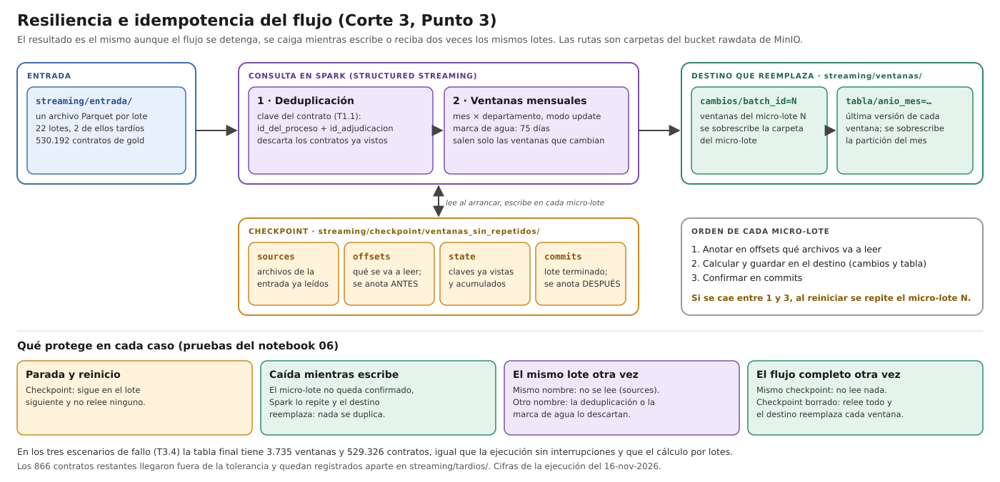

# Resiliencia e idempotencia del flujo (T3.5)

El flujo del Corte 3 lee los lotes que llegan a `streaming/entrada/`, descarta los contratos repetidos, los agrupa por mes y departamento y guarda el resultado en `streaming/ventanas/`. Tres piezas hacen que el resultado sea el mismo aunque el flujo se detenga, se caiga o reciba dos veces los mismos datos: el punto de control (checkpoint), el destino que reemplaza y la clave del contrato.

## Qué guarda el checkpoint

El checkpoint es una carpeta de MinIO que Spark escribe mientras procesa. Guarda cuatro cosas: los archivos de la entrada que ya encontró (`sources`); qué va a leer cada micro-lote y con qué marca de agua, anotado **antes** de procesarlo (`offsets`); qué micro-lotes terminaron, anotado **después** de guardarlos (`commits`); y el estado de la consulta, es decir, las claves de los contratos ya vistos y el acumulado de cada ventana abierta (`state`). Al reiniciar, Spark lee esa carpeta y sigue en el micro-lote siguiente al último confirmado, sin releer archivos.

## Por qué el destino reemplaza en vez de sumar

Spark garantiza que cada micro-lote se procesa al menos una vez, no exactamente una: si el proceso se cae después de guardar y antes de confirmar, al reiniciar repite ese micro-lote. Un destino que añade filas lo contaría dos veces. Por eso cada micro-lote hace dos escrituras que reemplazan: sobrescribe su propia carpeta en `cambios/batch_id=N` con las ventanas que cambió y, para los meses afectados, rehace la partición de `tabla/` con la última versión de cada ventana. Guardar el mismo micro-lote una, dos o diez veces deja las mismas cifras; con `append`, diez repeticiones del último micro-lote inflan la tabla de 529.326 a 738.456 contratos.

## Qué clave identifica un contrato

`id_del_proceso` + `id_adjudicacion`, la clave elegida en T1.1, única en gold y en los lotes (530.192 contratos, 530.192 claves). El flujo recuerda las claves de los meses abiertos y descarta las filas que las repiten. Así, un lote que vuelve a la entrada con otro nombre no cuenta dos veces; si vuelve con el mismo nombre, Spark ni siquiera lo lee, porque ya está anotado en `sources`.

## Qué pasa si el flujo se cae justo mientras escribe

El micro-lote no llega a anotarse en `commits`. La tabla conserva las cifras anteriores a ese micro-lote: está atrasada, pero no duplicada. Al reiniciar, Spark ve en `offsets` un micro-lote sin confirmar y lo repite con los mismos archivos, el mismo número y el mismo estado. El destino vuelve a escribir su carpeta de cambios y rehace completos los meses afectados a partir de `cambios/`, no de lo que hubiera quedado a medias en la tabla. En la prueba, el flujo se cayó a mitad de la escritura del lote 15 y terminó con las mismas 3.735 ventanas y 529.326 contratos que una ejecución sin interrupciones.

## Límites

- **Cambiar la consulta invalida el checkpoint.** El estado tiene la forma de la consulta que lo creó; otra clave de agrupación u otro operador con estado falla con `StateSchemaNotCompatible`. Hay que empezar con un checkpoint nuevo y volver a procesar la entrada.
- **Borrar el checkpoint hace que se relea toda la entrada.** Si la entrada es la misma, la tabla queda igual porque el destino reemplaza. Si es otra, hay que vaciar también `streaming/ventanas/`.
- **La deduplicación solo recuerda los meses abiertos** (75 días de tolerancia). Un repetido más antiguo se descarta por tardío, no por repetido; la tabla de tardíos de T2.5 debe deduplicarse por la misma clave antes de sumarla.
- **La clave no compara contenido.** Una versión corregida de un contrato ya visto se descarta; las correcciones se resuelven antes, en silver.
- **La caída se simuló** con un error entre las dos escrituras del destino. No se probó la muerte del proceso de Spark ni la pérdida del propio MinIO.

## Evidencia

Las pruebas están en `notebooks/06_corte3_resiliencia_idempotencia.ipynb` y sus capturas en `report/evidencias/`. El diagrama se genera con `scripts/dibujar_mecanismo.py` (`docs/mecanismo_resiliencia.png` es la versión para la presentación).

| Afirmación | Prueba | Resultado |
|---|---|---|
| Reiniciar no relee lotes | T3.1 | Tras parar en el lote 11, sigue con el 12 y lee 0 filas de los anteriores |
| Repetir un micro-lote no cambia la tabla | T3.2 | Mismas cifras tras guardarlo 1, 2 y 10 veces |
| Un lote repetido no cuenta dos veces | T3.3 | Mismo nombre: 0 filas leídas. Otro nombre: 20.913 leídas y todas descartadas |
| Parada, caída durante la escritura, flujo completo dos veces y lotes repetidos | T3.4 | 0 ventanas distintas frente a la ejecución limpia y al cálculo por lotes |
