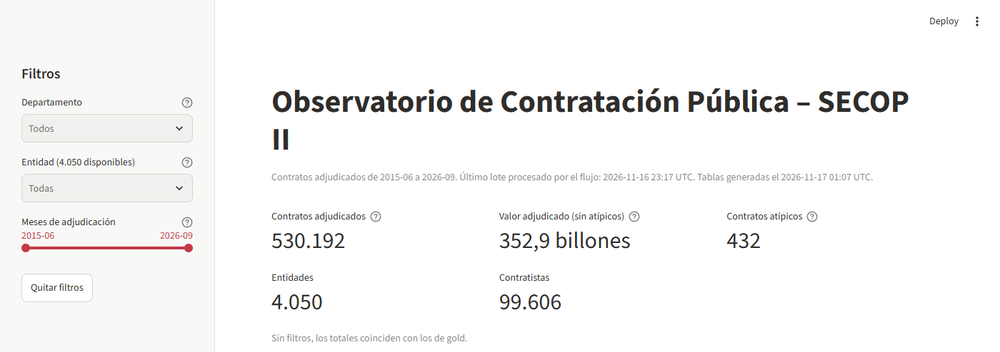
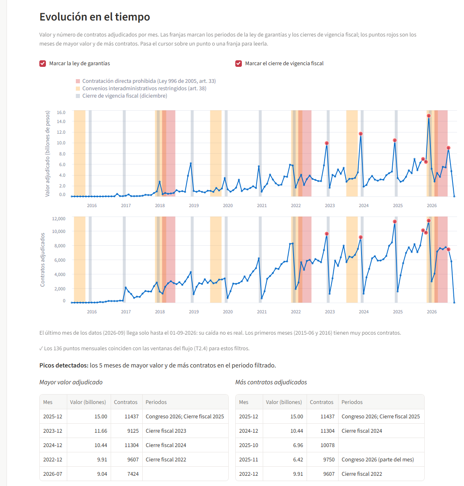
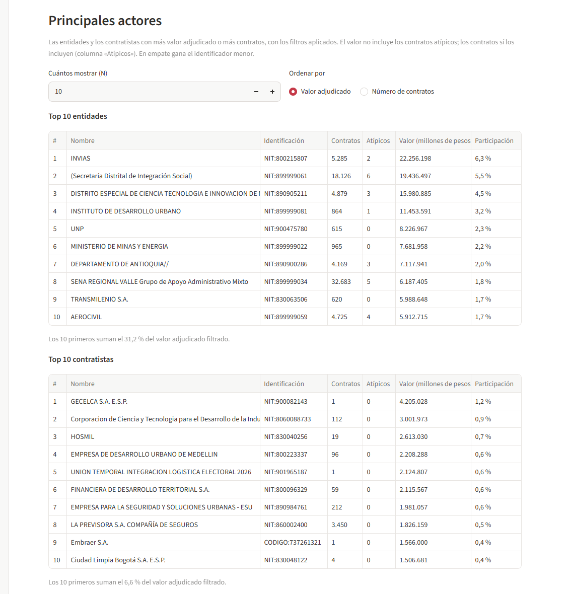
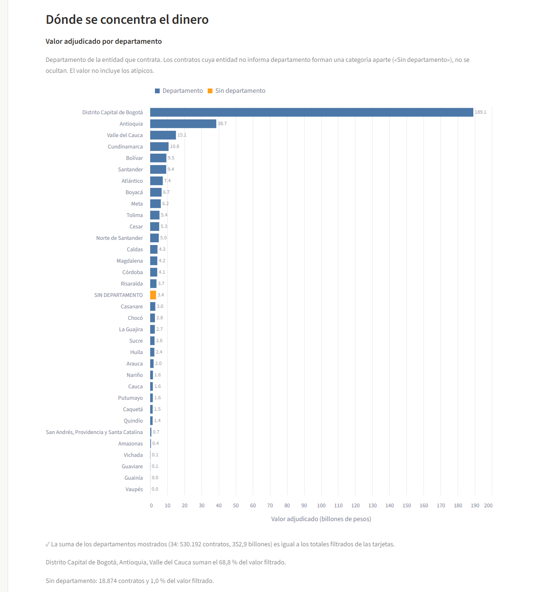
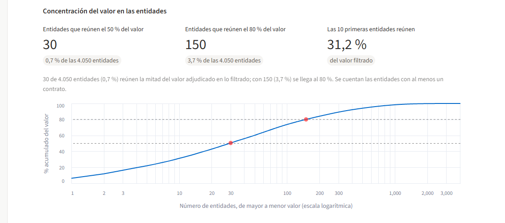
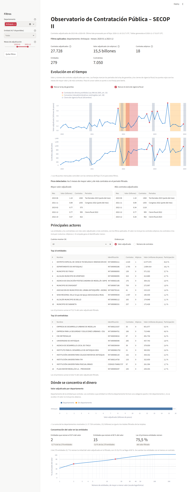
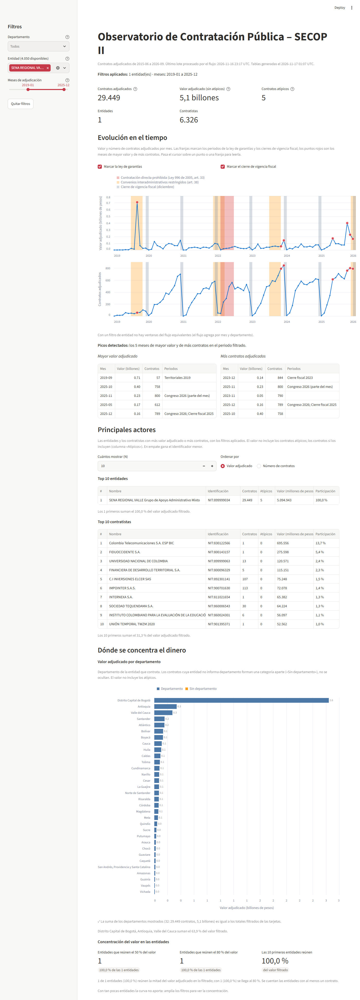
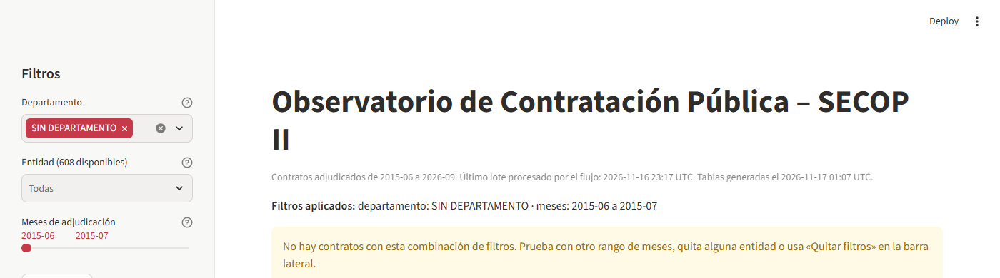

# Capturas comentadas del dashboard (T4.7)

Una captura por módulo y tres con filtros, tomadas el 16-nov-2026 con `scripts/capturar_dashboard.py` (Edge sin ventana, 1400 px de ancho, tema claro). Cada una se repite abriendo el dashboard con la dirección que figura en su ficha; los filtros van en la dirección (ver `dashboard/README.md`). Las cifras de las capturas son las que se comprobaron contra Spark sobre gold (ver «Pruebas de consistencia» en `dashboard/README.md`). Los valores no incluyen los contratos atípicos de T1.5, salvo que se diga lo contrario. Son el insumo de T5.6 y T6.2.

## 1. Cabecera y tarjetas, sin filtros

*Dirección:* `http://localhost:8501/`

**Qué muestra.** Los tres filtros abiertos (departamento, entidad y meses de 2015-06 a 2026-09) y las cinco tarjetas: 530.192 contratos adjudicados, 352,9 billones de pesos sin atípicos, 432 contratos atípicos, 4.050 entidades y 99.606 contratistas. Bajo el título, el periodo de los datos, la **fecha del último lote procesado por el flujo (2026-11-16 23:17 UTC)** y la de generación de las tablas; bajo las tarjetas, la comprobación de que los totales coinciden con gold.

**Qué permite concluir.** Es el universo de partida: 530.192 contratos adjudicados, con fecha, entidad y contratista, tras deduplicar y limpiar los 9,1 millones de filas del SECOP II. Los 432 atípicos son el 0,08 % de los contratos pero reúnen el 99,8 % del valor registrado en gold (errores de captura probables); por eso las cifras de valor del dashboard los excluyen y los muestran aparte.

## 2. Evolución en el tiempo, sin filtros

*Dirección:* `http://localhost:8501/`

**Qué muestra.** Valor adjudicado y número de contratos por mes, de 2015 a septiembre de 2026, con franjas para la contratación directa prohibida por la ley de garantías (rojo, tres elecciones presidenciales), los convenios interadministrativos restringidos (naranja, Congreso y territoriales) y cada diciembre (gris). Los puntos rojos son los cinco meses de mayor valor y de más contratos, y debajo se listan con los periodos que los tocan. La línea bajo el gráfico confirma que los 136 puntos coinciden con las ventanas del flujo (T2.4).

**Qué permite concluir.** (1) La contratación crece de forma sostenida: el promedio mensual pasa de unos 2.700 contratos en 2018 a unos 6.300 en los primeros ocho meses de 2026. (2) **Diciembre es el pico de cada año**: cuatro de los cinco meses de mayor valor son diciembre (2025-12: 15,00 billones y 11.437 contratos; 2023-12: 11,66; 2024-12: 10,44; 2022-12: 9,91), y entre 2017 y 2025 diciembre tiene entre 1,25 y 2,06 veces los contratos y entre 1,97 y 5,12 veces el valor del promedio de enero a noviembre; coincide con el cierre de vigencia fiscal. (3) **No se ve una caída consistente dentro de las franjas rojas**: de febrero a mayo de 2022 hubo 4.715 contratos al mes, entre los 3.190 de 2021 y los 5.172 de 2023. La serie cuenta todos los contratos adjudicados, no solo la contratación directa, así que no mide el efecto de la ley. (4) La caída del último mes no es real: los datos llegan hasta el 1 de septiembre de 2026.

## 3. Principales actores, sin filtros

*Dirección:* `http://localhost:8501/?n=10&orden=valor`

**Qué muestra.** Las 10 entidades y los 10 contratistas con más valor adjudicado, con sus contratos, atípicos, valor en millones de pesos y participación. Primera entidad: INVIAS, con 22,3 billones (6,3 %); las 10 primeras suman el 31,2 % del valor. Primer contratista: GECELCA S.A. E.S.P., con 4,2 billones (1,2 %); los 10 primeros suman el 6,6 %.

**Qué permite concluir.** El gasto está concentrado en pocas entidades, pero no en pocos contratistas: diez entidades reúnen casi un tercio del valor, y diez contratistas, el 6,6 %. Varios de los mayores contratistas lo son por **un solo contrato muy grande** (GECELCA, la unión temporal de logística electoral y Embraer tienen un contrato cada uno), así que el valor mide mal la actividad de un contratista: conviene leerlo junto a la columna de contratos. El nombre de una entidad es el más frecuente de su NIT: el NIT 899999034 (el SENA) aparece como «SENA REGIONAL VALLE» porque agrupa todas sus regionales.

## 4. Valor por departamento, sin filtros

*Dirección:* `http://localhost:8501/`

**Qué muestra.** El valor adjudicado de cada uno de los 34 grupos, de mayor a menor: Distrito Capital de Bogotá, 189,1 billones; Antioquia, 38,7; Valle del Cauca, 15,1; Cundinamarca, 10,8. En naranja, **«Sin departamento»: 3,4 billones (1,0 % del valor) y 18.874 contratos**, la categoría de los contratos cuya entidad no informa departamento. Bajo el gráfico, la suma de los 34 (530.192 contratos, 352,9 billones) coincide con las tarjetas.

**Qué permite concluir.** **Bogotá reúne el 53,6 % del valor y el 28,3 % de los contratos**: más que todos los demás departamentos juntos, con contratos de mayor tamaño. Bogotá, Antioquia y Valle del Cauca suman el 68,8 %, y ocho de los 34 grupos bastan para llegar al 80 %. Hay que leerlo con cuidado: el departamento es el de la **entidad que contrata**, no el de la obra o el servicio, así que las entidades nacionales con sede en Bogotá inflan su cifra.

## 5. Concentración en las entidades, sin filtros

*Dirección:* `http://localhost:8501/`

**Qué muestra.** Cuántas entidades reúnen el 50 % del valor (30), el 80 % (150) y cuánto suman las 10 primeras (31,2 %), con la curva del valor acumulado en escala logarítmica y los puntos del 50 % y el 80 %.

**Qué permite concluir.** **30 de las 4.050 entidades (0,7 %) reúnen la mitad del valor adjudicado**, 150 (3,7 %) el 80 % y 324 (8,0 %) el 90 %. Es la cifra de concentración para citar en el informe. No dice nada de la competencia dentro de cada contratación, solo cuántas entidades manejan el dinero.

## 6. Filtro: Antioquia, 2020 a 2023

*Dirección:* `http://localhost:8501/?departamento=Antioquia&desde=2020-01&hasta=2023-12`

**Qué muestra.** Con el departamento y el rango elegidos, **todos los módulos se actualizan a la vez**: 27.728 contratos, 15,5 billones, 18 atípicos, 279 entidades y 7.050 contratistas; la serie mensual de 48 puntos (sigue coincidiendo con el flujo); los rankings; una sola barra de departamento cuya suma es igual al total filtrado; y la curva de concentración de las 279 entidades.

**Qué permite concluir.** Dentro de un departamento el gasto también se concentra: **el Distrito Especial de Ciencia, Tecnología e Innovación de Medellín (42,5 % del valor) y el Departamento de Antioquia (18,1 %) reúnen el 60,6 %, y esas dos entidades bastan para llegar a la mitad** (15 de 279 para el 80 %). Las 10 primeras entidades suman el 75,5 %. Los dos mayores picos de valor del recorte son 2023-06 (1,10 billones) y 2021-11 (0,89 billones); la tabla de picos indica qué periodos tocan cada mes.

## 7. Filtro: una sola entidad (SENA), 2019 a 2025

*Dirección:* `http://localhost:8501/?entidad=NIT:899999034&desde=2019-01&hasta=2025-12`

**Qué muestra.** Con el NIT 899999034: 29.449 contratos, 5,09 billones, una entidad y 6.326 contratistas; el ranking de entidades tiene una fila; el de contratistas por valor lo encabezan Colombia Telecomunicaciones (un contrato de 696 mil millones), Fiduoccidente (uno de 276 mil millones) y la Universidad Nacional (13 contratos, 121 mil millones). La gráfica de departamentos reparte el valor entre 32 y la curva de concentración no se dibuja, porque con una sola entidad no hay nada que comparar (la app lo dice).

**Qué permite concluir.** Un NIT puede agrupar muchas dependencias: este tiene contratos en 32 departamentos. Un solo contrato (el de Colombia Telecomunicaciones) pesa el 13,7 % del valor de la entidad en el periodo, lo que confirma que el valor de un contratista depende a menudo de contratos aislados muy grandes.

## 8. Filtro sin resultados

*Dirección:* `http://localhost:8501/?departamento=SIN%20DEPARTAMENTO&desde=2015-06&hasta=2015-07`

**Qué muestra.** «SIN DEPARTAMENTO» y dos meses de 2015, una combinación sin contratos. En lugar de tarjetas y gráficos, un aviso claro: «No hay contratos con esta combinación de filtros», con qué probar. La línea «Filtros aplicados» recuerda qué se pidió.

**Qué permite concluir.** Una combinación vacía no produce un error ni cifras en cero que se confundan con datos: el usuario ve qué filtros la causaron y cómo salir (criterio 2 de T4.3).
